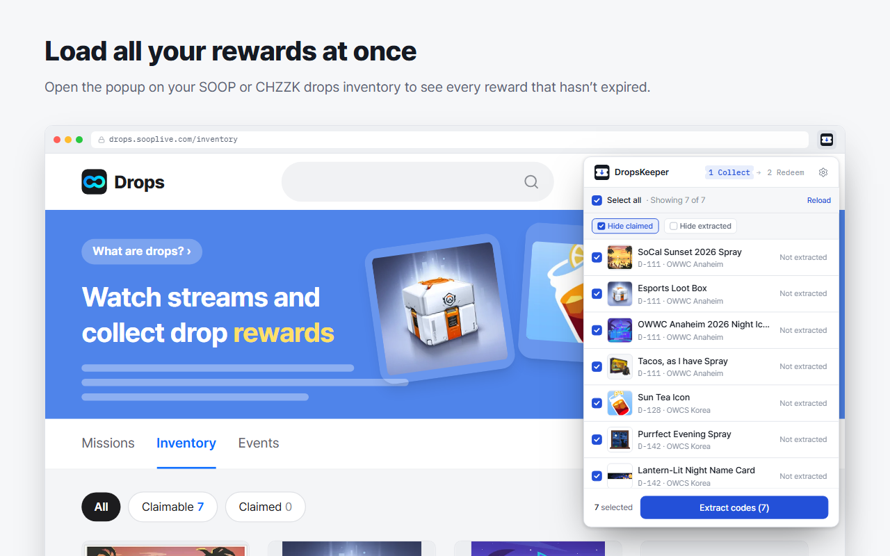
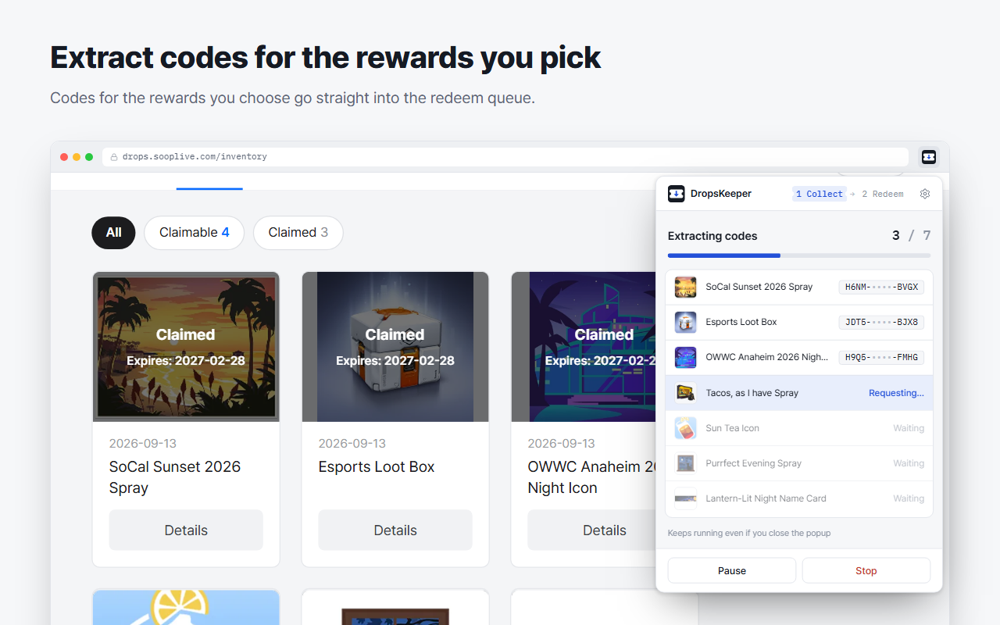
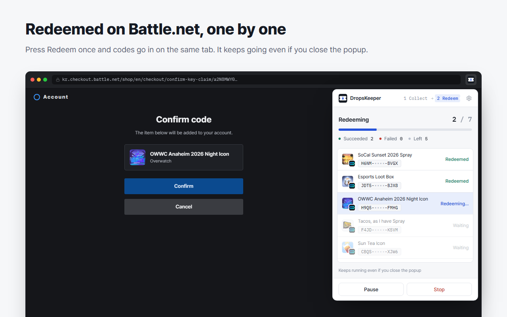
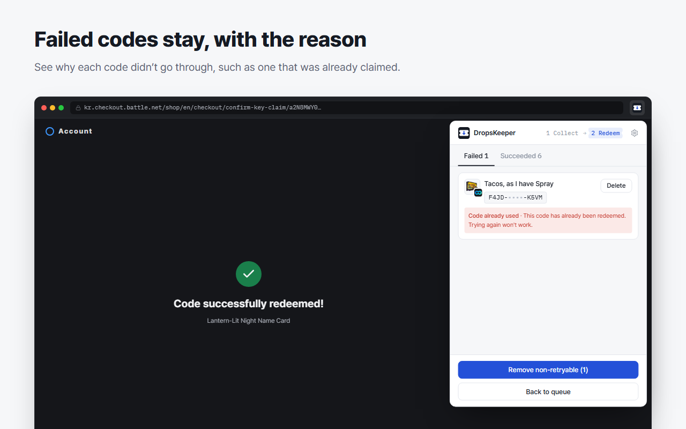

# DropsKeeper

[한국어](README.md) | **English**

A Chrome extension that collects drop reward codes from streaming platforms and redeems them on Battle.net one by one.
It currently supports SOOP and CHZZK drops (Overwatch).

- [Install from the Chrome Web Store](https://chromewebstore.google.com/detail/dropskeeper/coojibaldchcohkfcpjijepnifdgiema) (also works in Brave and other Chromium browsers)
- Website: [dropskeeper.junah.dev](https://dropskeeper.junah.dev/en/)

| | |
|---|---|
|  |  |
|  |  |

## How it works

1. Open the extension on your drops inventory and **Load rewards**
   - SOOP: `drops.sooplive.com/inventory`
   - CHZZK: `game.naver.com/profile#drops` (requires a NAVER sign-in)
2. Pick rewards and **Extract codes**
3. Open the extension again on the Battle.net code redemption page (`kr.checkout.battle.net/shop/en/checkout/key-claim`) and press **Redeem**
4. For failed codes, check the reason and **Retry**

## Development

```bash
pnpm install
pnpm dev          # dev mode (opens Chrome and reloads on changes)
pnpm build        # build to apps/extension/.output/chrome-mv3
pnpm compile      # type check
pnpm site:dev     # website dev server
pnpm site:build   # build the website to apps/site/dist
```

Load it yourself: `chrome://extensions` → Developer mode → **Load unpacked** → select `apps/extension/.output/chrome-mv3`

## Structure

A pnpm monorepo.

```
apps/
  extension/   the extension (WXT)
  site/        website dropskeeper.junah.dev (Astro, GitHub Pages)
packages/
  legal/       privacy policy and terms text, shared by the extension and the website
  popup-ui/    popup UI parts (colors, buttons, list rows), shared by the popup and the website demo
```

Inside the extension (`apps/extension`). All paths below are relative to `apps/extension`.

```
src/
  entrypoints/
    background.ts          job runner (extract and redeem queues, keeps going after the popup closes)
    soop.content.ts        calls the drops API on SOOP pages
    chzzk.content.ts       calls the CHZZK drops API on NAVER Game pages
    battlenet.content.ts   reads the Battle.net redemption page and clicks the confirm button
    popup/                 Preact + Tailwind popup
  lib/
    sources/               drops platforms (SOOP, CHZZK)
    redeem/battlenet/      Battle.net redemption page handling
    jobs.ts                extract and redeem job logic
    storage.ts             chrome.storage.local wrapper
    messages.ts            internal message types
```

## Adding a drops platform

1. Add an id to `SourceId` in `src/lib/types.ts` (e.g. `'twitch'`)
2. Add the inventory URL and match pattern to `sourceMetas` in `src/lib/sources/hosts.ts`
3. Implement `DropSource` (`listRewards`, `extractCode`) in `src/lib/sources/<id>.ts`
4. Register it in `src/lib/sources/index.ts`
5. Create `src/entrypoints/<id>.content.ts` (one `serveSource(...)` line)
6. Put the platform icon at `packages/popup-ui/src/assets/<id>.png` and add it to `sourceIcons` in `packages/popup-ui/src/icons.ts`

The popup, storage and redeem logic work off `SourceId`, so they need no changes.
host_permissions are generated from `sourceMetas` as well.

## Not yet verified

The Battle.net confirm page, error banners, and success and processing screens were checked against the real pages.
The error text for a product that can't be redeemed hasn't been seen yet, so it is still empty. Once known, add it to the text table in `src/lib/redeem/battlenet/page.ts`.

## Store screenshots and preview images

- Store screenshots (1280×800): `apps/site/store/<lang>/<n>.png`. Re-render with `node apps/site/store/render.mjs`
- Link preview images (1200×630): `apps/site/public/og/<lang>.png`. Re-render with `node apps/site/og/render.mjs`

Both use an installed Chromium browser (Brave, Chrome or Edge) in headless mode.

## Deploying the website

When `apps/site`, `packages/legal`, `packages/popup-ui`, or the extension text (`apps/extension/src/locales`) changes and is pushed to `main`, `.github/workflows/site.yml` deploys to GitHub Pages.

One-time setup:

1. Add a DNS CNAME record `dropskeeper.junah.dev` → `junah201.github.io`
2. In the repository, Settings → Pages → set Source to **GitHub Actions**
3. On the same screen, enter `dropskeeper.junah.dev` as the Custom domain and turn on **Enforce HTTPS**
